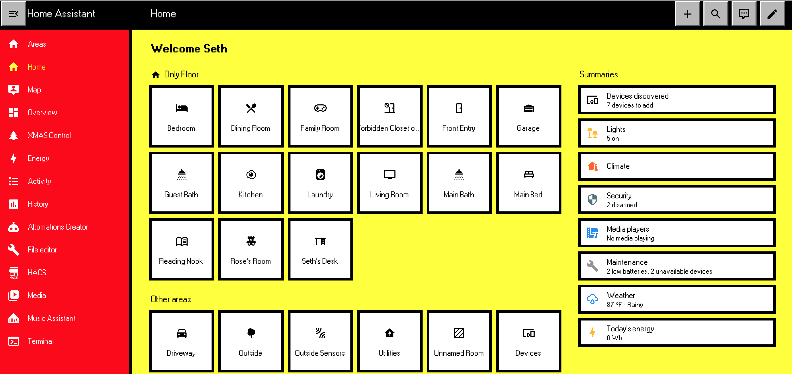

# Hot Dog Stand — a Home Assistant theme 🌭

Some people say the greatest interface color scheme ever created was shipped in Windows 3.1 by Microsoft in 1992. Now, this same theme can be used to control your home, on your mobile phone, on your desktop, in your home, at the ballpark, or even while visiting Costco. 

Anywhere you may encounter an actual hot dog, the Hot Dog Stand theme is there for you.

## Why? Why would you do this?

Some people may say "This looks horrible," and others may say, "My eyes are bleeding!" but also many, many more say "I love hot dogs!". 

There's clearly a high demand for hot dog stand colors and its simply shocking that Home Assistant doesn't provide this theme for users out of the box. This classic color scheme has been popular since last century and now it can be part of your modern home.

## What's in the box

- `hotdog-stand.yaml`: The theme file.
- A real bitmap "MS Sans Serif" font (the [98.css](https://github.com/jdan/98.css) webfont), loaded on every device so your dashboard reads like a BIOS setup screen on any phone, not just a Pentium.
- A small loader (`www/hotdog-font.js`) that installs the font and then helps with shaddow DOM elements.

## Installing 

Full steps are in [`SETUP.md`](SETUP.md). 

The short version: 

1. drop the theme in your `themes` folder, 
2. pick it in your profile, and you're done. 

Two optional add-ons ([card-mod](https://github.com/thomasloven/lovelace-card-mod) and the font loader) add square inputs, the red title bars, the gray buttons, and the bitmap font. 

Without them the theme still works and is still, unmistakably and unapologetically, a hot dog stand.

## Deliberate design decisions that are not bugs

- No hover animations. No ripples. No fades. You touch a thing, the thing changes. Windows 3.1 held no opinions about "delight" and neither do we.
- The code editor keeps its syntax colors. 
- Switches, sliders, chips, badges, toasts all live in the palette. On is yellow-on-black. Off is a little gray box. You will always know which.
- It is not subtle. This is just how it is. 

## Caveats

- A brand-new third-party card with deeply buried custom elements might slip through and render looking calm and modern. If you spot one, open an issue.
- Home Assistant moves fast. A frontend rewrite can shift the shadow-DOM paths that card-mod and the loader rely on. If something reverts to gray-and-blue after an update, that's the most likely reason.

## Credits

- The bitmap font comes from [98.css](https://github.com/jdan/98.css) by Jordan Scales (MIT). 
- The color scheme comes from Microsoft, who have never publicly explained themselves except this [one article](https://www.pcgamer.com/software/windows/windows-3-1-included-a-red-and-yellow-hot-dog-stand-color-scheme-so-garish-it-was-long-assumed-to-be-a-joke-so-i-tracked-down-the-original-designer-to-get-the-true-story/) where their first interface designer said Hot Dot Stand was not a joke, but they shipped it because they knew people using Windows may want an ugly UI. I may be paraphrasing here. 
- Card piercing is powered by [card-mod](https://github.com/thomasloven/lovelace-card-mod).
- Claude Code because who is going to have time to do all this in 2026 by hand.

## License

MIT. See [`LICENSE`](LICENSE). Do whatever you like with it. Wear sunglasses.
